# Asistente RAG sobre literatura latinoamericana

Un sistema de **Retrieval-Augmented Generation (RAG)** en español que responde preguntas sobre seis autores latinoamericanos usando solo lo que dicen sus artículos de Wikipedia.

**La consigna, en una línea:** armar un corpus propio en español, partirlo con dos estrategias de *chunking*, indexarlo con embeddings y FAISS, medir el buscador con `hit@k` sobre 10 preguntas anotadas, y comparar las respuestas de un LLM open-source **con RAG** y **sin RAG**, calificándolas a mano como Correcta, Parcial, Incorrecta o Alucinación.

| | |
|---|---|
| **Institución** | ISTEA |
| **Materia** | Aprendizaje Automático II |
| **Año / cuatrimestre** | 2026 — 2.º cuatrimestre |
| **Equipo** | Rodolfo Javier Berrone · Paola Lucía Pierolivo Fernández · Mauricio Chocholacek · Andrea Romeo · Verónica Andrea González · Daiana Marilyn Ruiz Díaz |
| **Entrega** | Trabajo Práctico 1 — PLN y RAG · 09/10/2026 |

[](https://colab.research.google.com/github/javi2481/rag-literatura-latinoamericana/blob/main/notebooks/TP1_RAG_Literatura_Latinoamericana.ipynb)


[](LICENSE)

## Contenido

- [El proyecto en una imagen](#el-proyecto-en-una-imagen)
- [Cómo funciona](#cómo-funciona)
- [1. El corpus](#1-el-corpus)
- [2. Chunking: A vs. B](#2-chunking-a-vs-b)
- [3. Embeddings e índice FAISS](#3-embeddings-e-índice-faiss)
- [4. Evaluación del buscador](#4-evaluación-del-buscador)
- [5. Generación: con RAG vs. sin RAG](#5-generación-con-rag-vs-sin-rag)
- [Qué aprendimos](#qué-aprendimos)
- [Reproducir](#reproducir)
- [Estructura del repositorio](#estructura-del-repositorio)
- [El notebook, sección por sección](#el-notebook-sección-por-sección)
- [Equipo](#equipo)
- [Glosario rápido](#glosario-rápido)
- [Créditos](#créditos)
- [Licencia](#licencia)

## El proyecto en una imagen

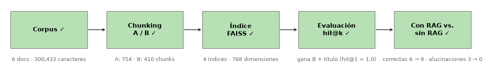

Sin contexto, el LLM respondió bien **6 de 10** preguntas e **inventó 3 datos** (Borges "nació en Mendoza", Cortázar "en Buenos Aires"). Con RAG respondió bien **9 de 10** y **no inventó ninguno**. Este README explica cómo llegamos a cada número, y por qué el único error con RAG no fue por falta de datos sino por elegir mal dentro del contexto.

## Cómo funciona

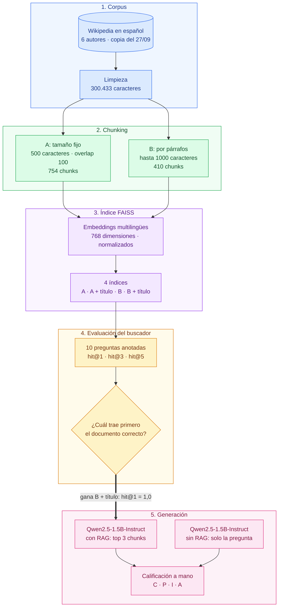

| Etapa | Pregunta que responde | Resultado |
|---|---|---|
| **1. Corpus** (azul) | ¿Sobre qué textos respondemos? | 6 artículos, 300.433 caracteres (5 veces el mínimo) |
| **2. Chunking** (verde) | ¿Cómo partimos los textos? | A: 754 chunks parejos · B: 410 chunks que respetan los párrafos |
| **3. Índice FAISS** (violeta) | ¿Cómo buscamos por significado? | 4 índices: A y B, con y sin el nombre del autor adelante |
| **4. Evaluación** (amarillo) | ¿Qué índice busca mejor? | B + título: el único que acierta el primer resultado en las 10 preguntas |
| **5. Generación** (rosa) | ¿Sirve el contexto? | Correctas 6 → 9 · alucinaciones 3 → 0 |

## 1. El corpus

Seis artículos de Wikipedia en español, uno por autor: **Jorge Luis Borges, Julio Cortázar, Gabriel García Márquez, Mario Vargas Llosa, Ernesto Sabato y Adolfo Bioy Casares**. Elegimos biografías con una estructura muy parecida (nacimiento, obras, premios, vida personal) a propósito: para responder "¿dónde nació Cortázar?" el buscador tiene que distinguir entre seis textos que hablan de nacimientos, ciudades y fechas.

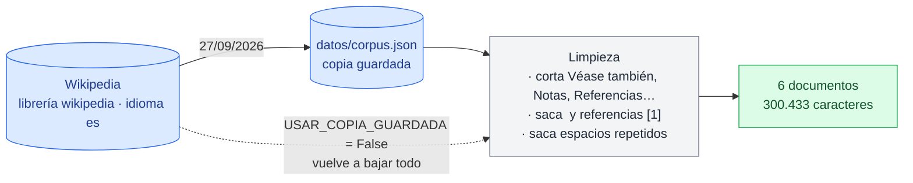

**Por qué una copia guardada.** Descargar en el momento trajo dos problemas: Wikipedia falla seguido cuando se le piden varios artículos seguidos, y los artículos se siguen editando (el de Borges cambió 54 caracteres entre el 27/09 y el 07/10, suficiente para cambiar los chunks y las respuestas). Por eso el notebook usa la copia del 27/09, que está en el repo. El código de descarga sigue ahí: con `USAR_COPIA_GUARDADA = False` se vuelve a bajar todo.

| Documento | Caracteres | Palabras (aprox.) | % del corpus |
|---|---:|---:|---:|
| Jorge Luis Borges | 96.226 | 15.453 | 32,0 |
| Mario Vargas Llosa | 59.178 | 9.730 | 19,7 |
| Gabriel García Márquez | 55.321 | 9.084 | 18,4 |
| Julio Cortázar | 33.731 | 5.487 | 11,2 |
| Ernesto Sabato | 31.505 | 5.199 | 10,5 |
| Adolfo Bioy Casares | 24.472 | 4.053 | 8,1 |
| **Total** | **300.433** | **49.006** | 100 |

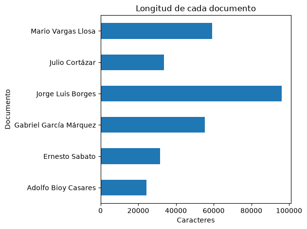

El corpus **no está balanceado**: Borges tiene cuatro veces más texto que Bioy Casares, y por eso más chunks y más chances de aparecer en los resultados aunque la pregunta sea sobre otro autor. Lo tuvimos en cuenta al analizar el buscador; no lo rebalanceamos.

## 2. Chunking: A vs. B

El modelo de embeddings tiene un límite de tokens, y un vector que resume un artículo entero mezcla demasiados temas. Por eso partimos cada artículo en fragmentos (*chunks*) y guardamos de qué documento viene cada uno, para poder medir el buscador.

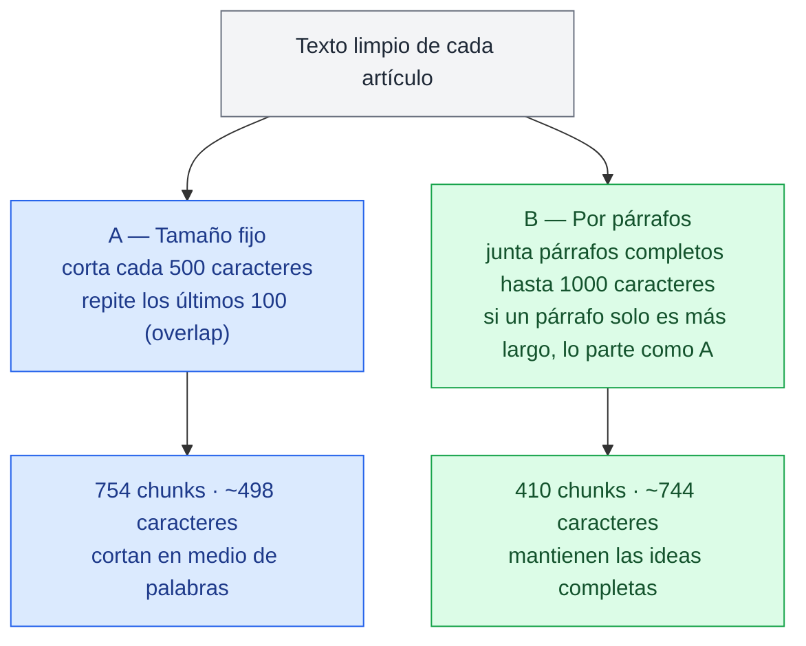

| | A — Tamaño fijo | B — Por párrafos |
|---|---:|---:|
| Cantidad de chunks | 754 | 410 |
| Longitud media (caracteres) | 497,6 | 743,6 |
| Longitud mínima | 72 | 103 |
| Longitud máxima | 500 | 1000 |

Un ejemplo del artículo de Cortázar: los chunks de A empiezan y terminan en medio de palabras (*"ue uno de los exponentes…"*, *"…al sur de la ciud"*), mientras que los de B mantienen los párrafos completos. **A simple vista B parecía más prometedora**, pero sus chunks son más largos, y en clase se mencionó que lo que mejor suele funcionar está entre 300 y 600 caracteres. Lo comprobamos con `hit@k` en la sección 4.

## 3. Embeddings e índice FAISS

Cada chunk se convierte en un vector de 768 números con `paraphrase-multilingual-mpnet-base-v2`, el modelo multilingüe visto en clase. Los vectores se normalizan y se guardan en un `faiss.IndexFlatIP`: con vectores normalizados, el producto interno es la similitud coseno. `buscar(pregunta, k)` convierte la pregunta en un vector con el mismo modelo y devuelve los `k` chunks más parecidos, con su score.

**Dos detalles que encontramos en el camino:**

1. **Truncado silencioso.** Por defecto el modelo lee solo los primeros 128 tokens y descarta el resto sin avisar. Muchos chunks, sobre todo los de B, son más largos. Subimos el límite a 320 tokens y verificamos que ningún chunk quede cortado (el más largo tiene 302).
2. **El modelo no sabe de quién habla un chunk.** En las primeras pruebas, ante *"¿Dónde nació Julio Cortázar?"* el primer resultado fue un chunk de **Bioy Casares** que también habla de un nacimiento. Muchos chunks dicen "su padre" o "el escritor" sin nombrar al autor. Por eso armamos una segunda versión de cada índice con el título del artículo pegado adelante (`"Julio Cortázar: ..."`) antes de calcular el vector.

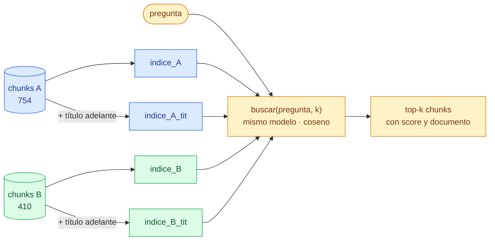

Los chunks y las preguntas son los mismos en los cuatro índices; solo cambia el texto del que sale el vector.

## 4. Evaluación del buscador

Armamos **10 preguntas con respuesta concreta**, repartidas entre los seis autores, y anotamos en qué documento está cada respuesta. Una pregunta es un *hit@k* si al menos uno de los `k` primeros chunks viene del documento correcto. Sumamos **precisión@5**: de los 5 chunks recuperados, qué proporción es del autor correcto, que es lo que después recibe el LLM como contexto.

| Configuración | hit@1 | hit@3 | hit@5 | precisión@5 |
|---|---:|---:|---:|---:|
| A — Tamaño fijo | 0,9 | 1,0 | 1,0 | 0,76 |
| A + título | 0,9 | 1,0 | 1,0 | **0,96** |
| B — Por párrafos | 0,8 | 1,0 | 1,0 | 0,58 |
| **B + título (ganador)** | **1,0** | 1,0 | 1,0 | 0,88 |

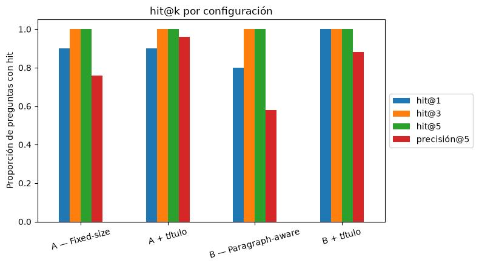

- **`hit@3` y `hit@5` no distinguen:** en las cuatro configuraciones el documento correcto siempre está entre los 3 primeros. La diferencia está en `hit@1`.
- **Sin título, B no mejora a A:** queda una pregunta abajo (0,8 contra 0,9) y es la que trae menos chunks del autor correcto (0,58).
- **Con título, B gana:** es la única con `hit@1` perfecto. **Agregar el nombre del autor influyó más que la estrategia de chunking**: la precisión@5 sube de 0,76 a 0,96 en A y de 0,58 a 0,88 en B.

> Con 10 preguntas, cada una vale 10 puntos porcentuales: estas diferencias son de una o dos preguntas y hay que tomarlas como orientativas.

El detalle del puesto en que aparece el documento correcto, pregunta por pregunta, está en [`resultados/puestos_por_pregunta.csv`](resultados/puestos_por_pregunta.csv).

## 5. Generación: con RAG vs. sin RAG

Usamos `Qwen/Qwen2.5-1.5B-Instruct`, un LLM chico que entra en la GPU T4 de Colab, en `float16` y **sin muestreo** (`do_sample=False`): siempre elige la palabra más probable, así las respuestas son las mismas en cada corrida.

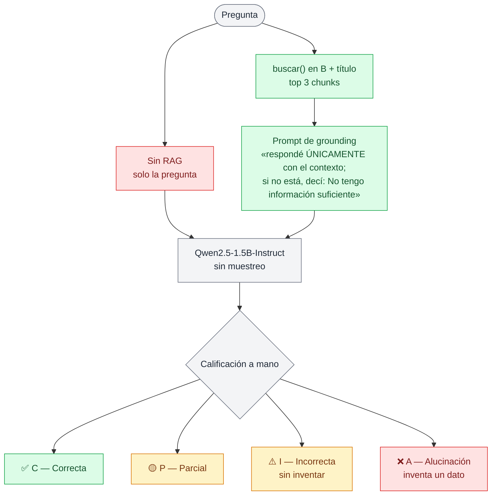

**Primero, una prueba trampa.** Le preguntamos algo que no existe: *"¿En qué año terminó Julio Cortázar sus estudios de Ciencia de Datos?"*. Sin RAG respondió con total seguridad **"en el año 1975"**. Con RAG respondió **"No tengo información suficiente."** El prompt de grounding cumple su función.

Después corrimos las 10 preguntas en los dos modos y calificamos las 20 respuestas en grupo:

| | Con RAG | Sin RAG |
|---|---:|---:|
| ✅ C — Correcta | **9 (90%)** | 6 (60%) |
| 🟡 P — Parcial | 0 | 1 (10%) |
| ⚠️ I — Incorrecta | 1 (10%) | 0 |
| ❌ A — Alucinación | **0** | 3 (30%) |

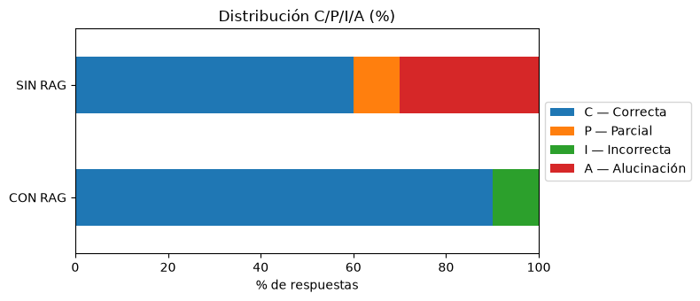

Tres preguntas, con las dos respuestas lado a lado:

| Pregunta | Sin RAG | Con RAG | Qué muestra |
|---|---|---|---|
| ¿Dónde nació Julio Cortázar? | "Buenos Aires, Argentina" ❌ A | "Ixelles, … Bruselas, Bélgica" ✅ C | RAG corrige una alucinación |
| ¿Qué premio recibió García Márquez en 1982? | "Premio Nobel de Literatura" ✅ C | "Medalla de la Legión de Honor de Francia" ⚠️ I | RAG empeora: elige otro premio de la lista |
| ¿Dónde nació Ernesto Sabato? | "Buenos Aires, Argentina" 🟡 P | "Rojas, Buenos Aires" ✅ C | RAG agrega precisión |

Las 20 respuestas con su calificación están en [`resultados/respuestas_con_sin_rag.csv`](resultados/respuestas_con_sin_rag.csv).

**Dos calificaciones que discutimos:**
- **"Palermo, Argentina"** (Borges, con RAG) quedó como **C**: no nombra Buenos Aires, pero el chunk dice que nació en Palermo, entonces un suburbio de Buenos Aires. Es correcto y más preciso.
- **"Legión de Honor"** (García Márquez, con RAG) quedó como **I** y no como alucinación: el dato existe, está en el contexto, pero es de 1981 y no es el premio que se preguntaba.

## Qué aprendimos

1. **El buscador entiende el *qué*, pero no el *de quién*.** El modelo de embeddings capta bien el tipo de pregunta ("¿dónde nació…?") y le da poco peso al nombre propio. Pegar el título del artículo a cada chunk fue la mejora más grande de todo el trabajo, más que cambiar la estrategia de chunking.
2. **Más grande no es mejor por sí solo.** Los chunks por párrafos se ven mejor, pero sin título buscan peor que los de tamaño fijo. Solo ganan cuando cada vector "sabe" de qué autor habla.
3. **RAG elimina las alucinaciones…** Sin contexto el modelo acierta los datos famosos (los Nobel, *Cien años de soledad*) e inventa los específicos (dónde nació cada autor). Con RAG las preguntas de lugar de nacimiento pasan de 1 de 4 a 4 de 4.
4. **…pero no garantiza elegir bien.** En la pregunta del Nobel de 1982, el dato correcto estaba en el contexto, junto con una lista de premios de años cercanos, y el modelo eligió otro. No inventó: eligió mal. Creemos que influye el tamaño del modelo (1.500 millones de parámetros).
5. **El dato siempre llegó.** En las 10 preguntas la palabra clave de la respuesta estaba en los 3 chunks que recibió el LLM. Los errores de generación no fueron culpa del buscador.

> **Ojo con leer estos números como definitivos.** Son 10 preguntas, todas nombran al autor (lo que facilita la búsqueda), el índice de RAG lo elegimos con las mismas preguntas con las que evaluamos la generación, y los prompts con y sin RAG no son idénticos.

**Qué haríamos distinto:** cortar los chunks en los títulos de sección y probar tamaños entre 300 y 600 caracteres; evaluar el buscador por chunk (si el chunk contiene la respuesta) y no solo por documento; sumar preguntas que no nombren al autor ("¿quién escribió *Rayuela*?") para que `hit@3` y `hit@5` distingan; usar el mismo formato de prompt en los dos modos, probar un LLM más grande y un *reranking* de los primeros resultados.

## Reproducir

> **Google Drive en el proyecto original vs. en este repo.** Durante el trabajo práctico el notebook bajaba el corpus de un link público de Google Drive y necesitaba una GPU T4 para cargar el LLM. Para que cualquiera pueda reproducirlo sin cuentas ni permisos, este repo trae todo incluido: el corpus en `datos/corpus.json` y las respuestas que dio el LLM en `resultados/respuestas_llm.json`. **No hace falta Google Drive, ninguna API key ni GPU:** se clona, se instalan las dependencias y se ejecuta.

**La forma más rápida:** el botón **Abrir en Colab** de arriba y *Entorno de ejecución → Ejecutar todo*. Si el notebook no encuentra la carpeta `datos/`, clona este repo solo.

**En local:** Python 3.12 (es la versión con la que se probó) y `pip`.

```bash
git clone https://github.com/javi2481/rag-literatura-latinoamericana.git
cd rag-literatura-latinoamericana
pip install -r requirements.txt
```

Después, abrir `notebooks/TP1_RAG_Literatura_Latinoamericana.ipynb` (VS Code, Jupyter o Colab) y *Reiniciar y ejecutar todo*.

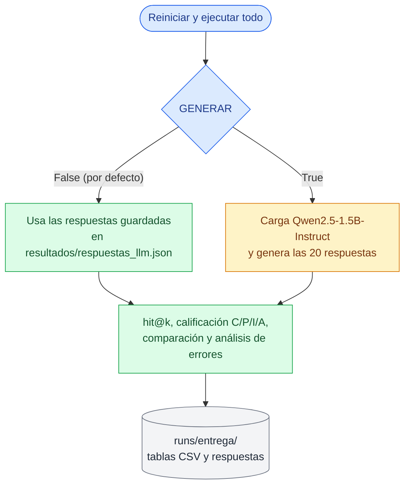

| Modo | Cómo se activa | Tiempo aproximado | Resultado |
|---|---|---|---|
| Respuestas guardadas | `GENERAR = False` (por defecto) | ≈ 4 min en CPU, incluida la descarga del modelo de embeddings (1,1 GB) | Los mismos números de la entrega |
| Generar de nuevo | `GENERAR = True` en la celda de preparación | Necesita GPU (en Colab, T4), más la descarga del LLM (3,1 GB) | Las mismas respuestas: se generan sin muestreo |

Las dos banderas viven en el notebook: `GENERAR` en la celda de preparación y `USAR_COPIA_GUARDADA` en la sección 4. El buscador, los índices y `hit@k` **se calculan siempre**: lo único que se puede saltear es la generación del LLM.

## Estructura del repositorio

```text
.
├── datos/
│   ├── corpus.json                  # copia del corpus del 27/09: lo que usa el notebook
│   └── textos/                      # los mismos 6 artículos en Markdown, para leerlos en GitHub
├── notebooks/
│   └── TP1_RAG_Literatura_Latinoamericana.ipynb   # notebook ejecutado, con todas las salidas
├── resultados/
│   ├── respuestas_llm.json          # respuestas del LLM (entrada cuando GENERAR = False)
│   ├── tabla_hit_k.csv              # hit@1/3/5 y precisión@5 de los 4 índices
│   ├── puestos_por_pregunta.csv     # en qué puesto aparece el documento correcto
│   ├── respuestas_con_sin_rag.csv   # las 20 respuestas con su nota C/P/I/A
│   └── tabla_CPIA.csv               # conteo y % de cada nota, con y sin RAG
├── figuras/                         # imágenes de este README (salen del notebook)
├── requirements.txt
├── LICENSE                          # licencia MIT
└── README.md
```

Al ejecutar el notebook se crea `runs/entrega/` con una copia de las tablas. Esa carpeta está en `.gitignore`.

Cómo se conectan las carpetas con el notebook:

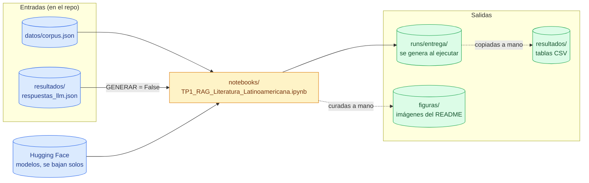

**Fuente de verdad.** Todos los números de este README salen del notebook ejecutado. Si se cambia algo en el notebook, se actualizan juntos el notebook, `resultados/`, `figuras/` y este README.

## El notebook, sección por sección

| Sección | Qué hace | Lee | Escribe |
|---|---|---|---|
| 1. Título e integrantes | Equipo, roles y cómo correrlo | — | — |
| Instalación e importación | Instala dependencias, define `GENERAR`, rutas y el mapa de progreso | — | — |
| 2 – 3. Introducción, corpus y objetivos | Qué es RAG, por qué este corpus y qué preguntas esperamos responder | — | — |
| 4. Descarga y limpieza | Carga la copia del 27/09 (o baja de Wikipedia) y limpia el ruido | `datos/corpus.json` | — |
| 5. Estadísticas | Documentos, caracteres, palabras y distribución de longitudes | — | — |
| 6 – 7. Chunking | Estrategias A y B, comparación y ejemplos lado a lado | — | — |
| 8. Embeddings e índice FAISS | Modelo, control de truncado y 4 índices (con y sin título) | Hugging Face | — |
| 9. Función de búsqueda | `buscar(pregunta, k)` y tres pruebas | — | — |
| 10. Set de evaluación | 10 preguntas con documento fuente y respuesta esperada | — | — |
| 11. Resultados del buscador | `hit@1/3/5` y precisión@5 de los 4 índices | — | — |
| 12 – 13. Generación con y sin RAG | LLM, prompt de grounding y prueba con una pregunta inventada | `resultados/respuestas_llm.json` o Hugging Face | — |
| 14. Evaluación C/P/I/A | Las 20 respuestas y su calificación | — | — |
| 15. Comparación | Tabla C/P/I/A, tres preguntas lado a lado y guardado | — | `runs/entrega/` |
| 16. Reporte final | Corpus, resultados, análisis de errores y conclusiones | — | — |

## Equipo

| Rol | Integrante | Responsabilidad |
|---|---|---|
| 1 | Rodolfo Javier Berrone | Corpus: descarga, limpieza y estadísticas |
| 2 | Paola Lucía Pierolivo Fernández | Chunking A y B, y su comparación |
| 3 | Mauricio Chocholacek | Embeddings, índice FAISS y función `buscar()` |
| 4 | Andrea Romeo | Set de 10 preguntas y evaluación `hit@k` |
| 5 | Verónica Andrea González | LLM con y sin RAG, y calificación C/P/I/A |
| 6 | Daiana Marilyn Ruiz Díaz | Notebook final e informe |

Así se repartió el trabajo. Lo primero, entre todos, fue elegir el tema, porque bloqueaba todo lo demás. Después, algunas partes pudieron arrancar en paralelo desde el día 1 (línea punteada) y otras tuvieron que esperar la entrega de la anterior:

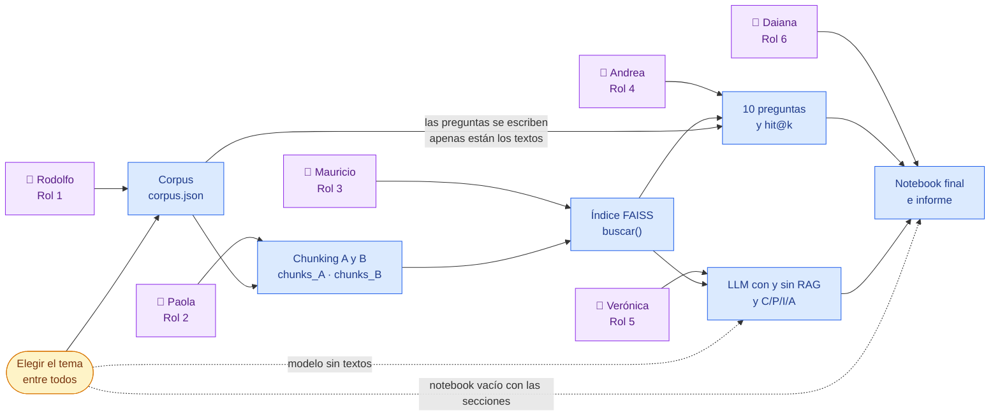

## Glosario rápido

| Término | Qué significa |
|---|---|
| **RAG** | Buscar primero los fragmentos relevantes de un corpus y pasárselos al LLM para que responda con ellos |
| **Chunk** | Cada fragmento en que se parte un texto para buscarlo |
| **Overlap** | Caracteres que se repiten entre un chunk y el siguiente, para no perder información en el corte |
| **Embedding** | Vector de números que representa el significado de un texto; textos parecidos quedan cerca |
| **FAISS** | Librería para guardar vectores y encontrar rápido los más parecidos a uno dado |
| **Similitud coseno** | Qué tan parecidas son las direcciones de dos vectores: 1 si apuntan igual |
| **hit@k** | Proporción de preguntas en las que el documento correcto aparece entre los `k` primeros resultados |
| **precisión@5** | De los 5 chunks recuperados, qué proporción viene del documento correcto |
| **Prompt de grounding** | Instrucción que obliga al LLM a responder solo con el contexto que recibe |
| **Alucinación** | Cuando el modelo inventa un dato concreto y falso con total seguridad |

## Créditos

- Notebook de clase `PLN_RAG_pipeline` (Aprendizaje Automático II, Prof. César Martínez): base para la descarga de Wikipedia, el índice FAISS, la búsqueda y la generación con el LLM.
- [Wikipedia en español](https://es.wikipedia.org/): artículos de los seis autores, descargados el 27/09/2026 ([CC BY-SA 4.0](https://creativecommons.org/licenses/by-sa/4.0/deed.es)).
- [`sentence-transformers/paraphrase-multilingual-mpnet-base-v2`](https://huggingface.co/sentence-transformers/paraphrase-multilingual-mpnet-base-v2): modelo de embeddings.
- [`Qwen/Qwen2.5-1.5B-Instruct`](https://huggingface.co/Qwen/Qwen2.5-1.5B-Instruct): LLM generativo.
- [FAISS](https://github.com/facebookresearch/faiss): índice vectorial.

## Licencia

El código es un proyecto académico distribuido bajo la [licencia MIT](LICENSE). Los textos de `datos/` son de Wikipedia y mantienen su licencia original, [CC BY-SA 4.0](https://creativecommons.org/licenses/by-sa/4.0/deed.es).
